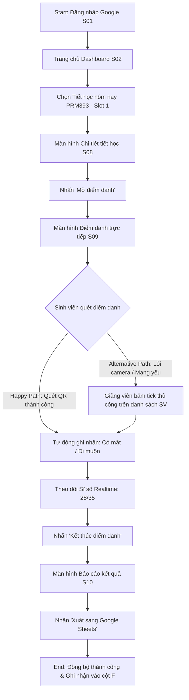
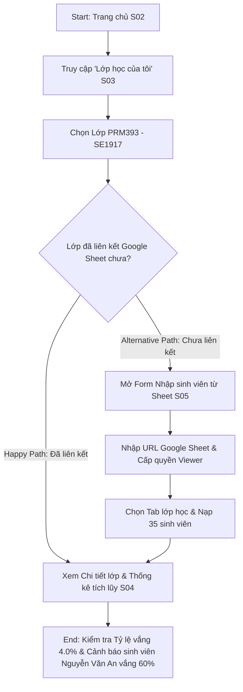
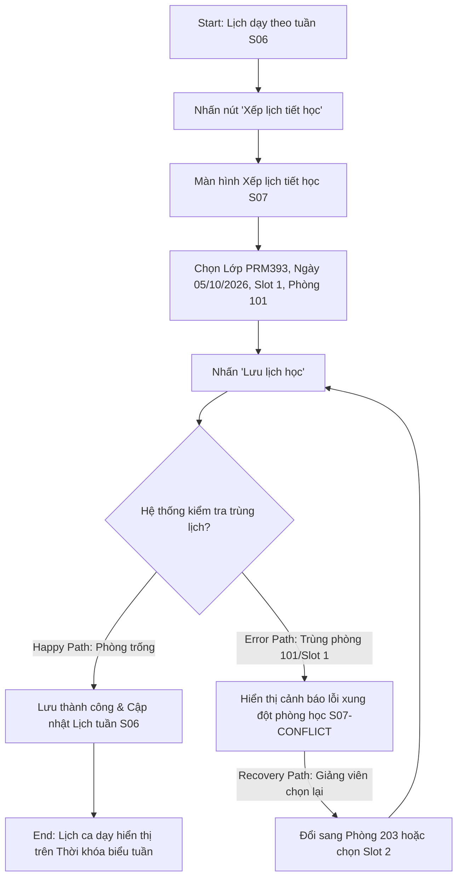

# Information Architecture & User Flows

## 1. Information Architecture (Screen Inventory)

Hệ thống **FPT Attendance System (CAMPUS / STUDIO)** bao gồm 10 màn hình chức năng chính và 1 màn hình tích hợp, được phân cấp rõ ràng giữa Màn hình cấp cao (Top-Level) và Màn hình chi tiết nghiệp vụ (Nested Screens):

### Danh Mục Màn Hình Chuẩn Hóa (Screen Inventory)
- **Top-Level Screens (Màn hình Cấp cao):**
  - **S01: Đăng nhập (Google SSO)** — Xác thực danh tính 1-Touch bằng tài khoản FPT Education (`@fpt.edu.vn`)
  - **S02: Tổng quan giảng dạy (Home Dashboard)** — Quản lý ca học hôm nay, thẻ Tiết đang điểm danh ưu tiên cao nhất, nút Tạo lớp & Xếp lịch
  - **S03: Lớp học của tôi (Class List)** — Danh sách các lớp phụ trách: PRM393 (SE1917), PRN232 (SE1918), SWP391 (SE1908)
  - **S06: Lịch dạy theo tuần (Schedule Calendar)** — Thời khóa biểu tuần di động, bộ chọn ngày thứ T2–CN có chấm báo hiệu ca dạy
  - **S11: Tài khoản & kết nối (Account & Integration)** — Quản lý hồ sơ Giảng viên Nguyễn Văn Nam (`namnv@fpt.edu.vn`), kết nối Google Workspace

- **Nested & Flow-Specific Screens (Màn hình Chi tiết & Nghiệp vụ):**
  - **S04: Chi tiết lớp học (Class Detail & Thống kê tích lũy)** — Tỷ lệ vắng 4.0%, danh sách sinh viên vắng nhiều cảnh báo nguy cơ cấm thi
  - **S05: Nhập sinh viên từ Sheet (3-Step Wizard)** — Quy trình 3 bước: Chọn file $\rightarrow$ Chọn tab $\rightarrow$ Kết quả đồng bộ 35 sinh viên
  - **S07: Xếp lịch tiết học (Schedule Creation & Conflict Detection)** — Form tạo lịch dạy, phát hiện xung đột phòng học (Phòng 101 / Slot 1)
  - **S08: Chi tiết tiết học (Session Detail)** — Thông tin ca học PRM393 Slot 1 (07:00–09:15) Phòng 101, cảnh báo giờ & Nút "Mở điểm danh"
  - **S09: Điểm danh trực tiếp (Live Dynamic QR Session)** — Mã QR động đếm ngược 45s, sĩ số realtime 28/35, nút Phóng to QR & Kết thúc điểm danh
  - **S10: Báo cáo điểm danh (Attendance Report & Sheets Export)** — Tổng kết ca học (26 có mặt, 2 muộn, 7 vắng), Nút xuất sang Cột F Google Sheet

### Sơ Đồ Cấu Trúc Cây Kiến Trúc Thông Tin (Information Architecture Tree)

```text
                           [CAMPUS / STUDIO APP]
                                     │
                    ┌────────────────┴────────────────┐
                    │  S01: Đăng nhập (Google SSO)    │
                    └────────────────┬────────────────┘
                                     │ (OAuth Success)
                                     ▼
                    ┌─────────────────────────────────┐
                    │  S02: Tổng quan giảng dạy       │
                    │  (Home Dashboard)               │
                    └───┬─────────────┬─────────────┬─┘
                        │             │             │
        ┌───────────────┘             │             └───────────────┐
        ▼                             ▼                             ▼
 ┌──────────────┐              ┌──────────────┐              ┌──────────────┐
 │  S03:        │              │  S06:        │              │  S11:        │
 │  Lớp học của │              │  Lịch dạy    │              │  Tài khoản & │
 │  tôi         │              │  theo tuần   │              │  kết nối     │
 └───┬──────────┘              └───┬──────────┘              └──────────────┘
     │                             │
     ├──────────────────────┐      │
     ▼                      ▼      ▼
 ┌──────────────┐          ┌──────────────┐
 │  S05:        │          │  S07:        │
 │  Nhập SV từ  │          │  Xếp lịch    │
 │  Google Sheet│          │  tiết học mới│
 └───┬──────────┘          └──────────────┘
     │ (Đồng bộ 35 SV)
     ▼
 ┌──────────────┐
 │  S04:        │
 │  Chi tiết lớp│
 │  & Thống kê  │
 └──────────────┘

        [LUỒNG ĐIỂM DANH CỐT LÕI (CORE ATTENDANCE FLOW)]
        S02: Tổng quan giảng dạy
             │ (Nhấn "Xem điểm danh" trên card PRM393)
             ▼
        S08: Chi tiết tiết học (Slot 1 · Phòng 101)
             │ (Nhấn "Mở điểm danh")
             ▼
        S09: Điểm danh trực tiếp (Dynamic QR 45s + Feed Realtime 28/35)
             │ (Nhấn "Kết thúc điểm danh")
             ▼
        S10: Báo cáo điểm danh (Có mặt: 26, Muộn: 2, Vắng: 7)
             │ (Nhấn "Xuất sang Google Sheets")
             ▼
        [Google Sheets: Dữ liệu tự động ghi vào Cột F tab 12_PRM393_SE1917]
```

---

## 2. User Flows (3 Sơ đồ Chi tiết với Happy Path, Nhánh Thay Thế & Phục Hồi)

### User Flow 1: Mở ca học, Điểm danh trực tiếp qua mã QR động & Xuất Google Sheets
- **Điểm bắt đầu (Start):** Mở ứng dụng & Đăng nhập Google SSO FPT Education (**S01**)
- **Mục tiêu (Goal):** Hoàn thành buổi điểm danh cho ca học PRM393 và đồng bộ dữ liệu vào Google Sheets trong dưới 30 giây
- **Điểm kết thúc (End):** Dữ liệu điểm danh được ghi vào cột F của Google Sheet và hoàn tất phiên (**S10**)
- **Nhánh thành công (Happy Path):** Mở Live QR 45s $\rightarrow$ Sinh viên quét đủ $\rightarrow$ Kết thúc phiên $\rightarrow$ Xuất sang Google Sheets.
- **Nhánh thay thế (Alternative Path):** Sinh viên camera hỏng / không quét kịp $\rightarrow$ Giảng viên chuyển sang tab danh sách bấm đánh dấu thủ công (Manual Override) $\rightarrow$ Ghi nhận "Có mặt" $\rightarrow$ Tiếp tục xuất Sheets.



---

### User Flow 2: Quản lý Lớp học, Kết nối Google Sheet & Xem Thống kê Chuyên cần tích lũy
- **Điểm bắt đầu (Start):** Trang chủ Dashboard (**S02**)
- **Mục tiêu (Goal):** Quản lý sĩ số lớp và theo dõi các sinh viên có nguy cơ cấm thi
- **Điểm kết thúc (End):** Xem chi tiết sinh viên vắng nhiều (Nguyễn Văn An 60%) và quản lý học kỳ (**S04**)
- **Nhánh thành công (Happy Path):** Lớp đã liên kết Google Sheet $\rightarrow$ Mở xem ngay báo cáo thống kê tích lũy (**S04**).
- **Nhánh thay thế (Alternative Path):** Lớp mới chưa liên kết $\rightarrow$ Mở Wizard 3 bước nhập Google Sheet (**S05**) $\rightarrow$ Nạp 35 sinh viên $\rightarrow$ Xem thống kê.



---

### User Flow 3: Xếp lịch tiết học mới & Xử lý Xung đột Lịch dạy (Error & Recovery Path)
- **Điểm bắt đầu (Start):** Lịch dạy theo tuần (**S06**) hoặc Trang chủ (**S02**)
- **Mục tiêu (Goal):** Tạo lịch học mới cho môn học và phòng học mong muốn
- **Điểm kết thúc (End):** Lưu lịch học thành công sau khi giải quyết xung đột phòng học / slot học (**S07** $\rightarrow$ **S06**)
- **Nhánh thành công (Happy Path):** Chọn phòng trống và slot hợp lệ $\rightarrow$ Hệ thống lưu thành công $\rightarrow$ Cập nhật vào Lịch tuần (**S06**).
- **Nhánh lỗi & phục hồi (Error & Recovery Path):** Chọn Phòng 101 đã bị trùng ca $\rightarrow$ Báo lỗi xung đột (`S07-CONFLICT`) $\rightarrow$ Giảng viên chọn phòng khác (Phòng 203) hoặc đổi Slot 2 (Recovery) $\rightarrow$ Lưu thành công (`S07-SUCCESS`).



---

## 3. Bảng Ánh Xạ User Flow Sang Màn Hình (Flow-to-Screen Mapping Table)

| User Flow | Mã Màn Hình Sử Dụng | Hành Động Chính Của Người Dùng | Trạng Thái Ngoại Lệ / Lỗi Được Xử Lý |
| :--- | :---: | :--- | :--- |
| **Flow 1: Live QR Attendance & Sheets Export** | **S01, S02, S08, S09, S10** | Đăng nhập Google, mở tiết học, phát mã QR động 45s, theo dõi sĩ số realtime 28/35, kết thúc và xuất Google Sheets | Sinh viên mạng yếu / camera hỏng $\rightarrow$ Giảng viên tick điểm danh thủ công; Tránh ghi đè nhầm Sheet bằng Dialog xác nhận |
| **Flow 2: Class Management & Sheets Sync** | **S02, S03, S05, S04** | Xem danh sách lớp, kết nối Google Sheet 3 bước, kiểm tra tỷ lệ vắng 4.0% và danh sách sinh viên vắng nhiều | URL Google Sheet sai quyền $\rightarrow$ Báo lỗi không đọc được file và hướng dẫn cấp quyền Viewer |
| **Flow 3: Schedule Creation & Conflict Recovery** | **S02, S06, S07** | Tạo lịch ca học mới, phát hiện xung đột phòng 101 / slot học, chọn lại slot phòng và lưu thành công | Xung đột Phòng 101 / Slot 1 $\rightarrow$ Hiển thị `S07-CONFLICT` và cho phép chọn Phòng 203 hoặc Slot khác |
